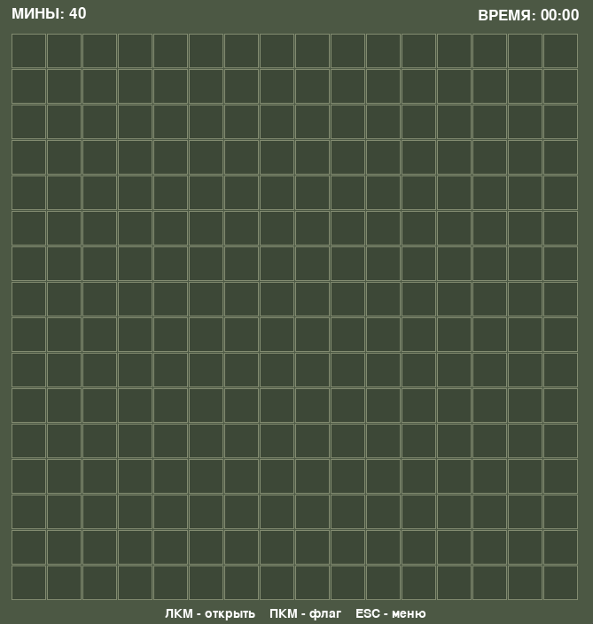
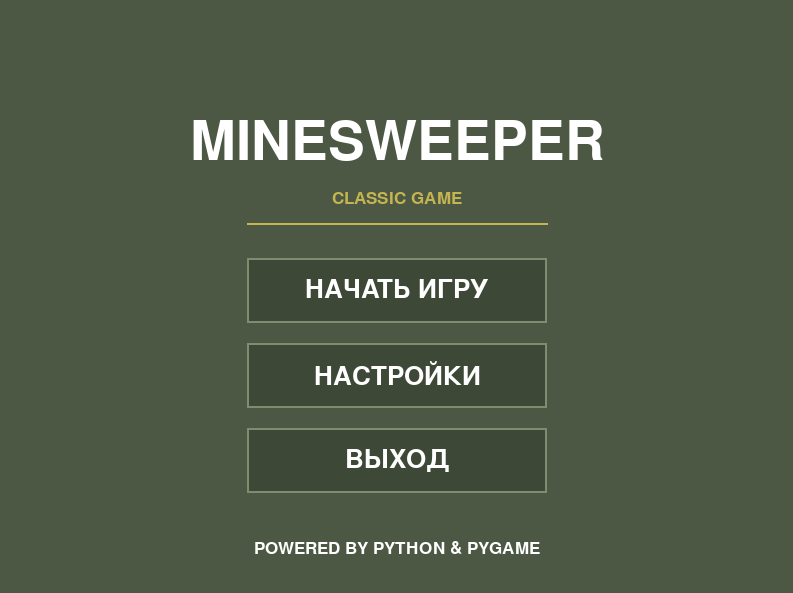
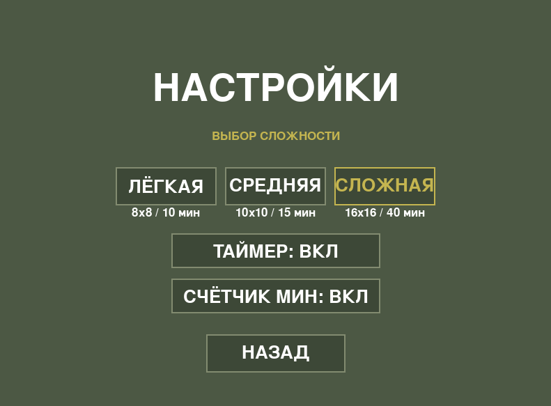

# Minesweeper

Игра «Сапёр», разработанная на Python с использованием библиотеки Pygame.
 
## О проекте

Minesweeper — это компьютерная версия классического «Сапёра» с главным меню, настройками сложности и несколькими игровыми режимами.
## Главное меню

## Возможности

- Три уровня сложности.
- Настройка отображения таймера.
- Настройка отображения счётчика мин.
- Система флажков.
- Автоматическое открытие пустых клеток.
- Отслеживание победы и поражения.
- Возможность перезапустить игру.

## Уровни сложности

| Сложность | Размер поля | Количество мин |
|---|---:|---:|
| Лёгкая | 8 × 8 | 10 |
| Средняя | 10 × 10 | 15 |
| Сложная | 16 × 16 | 40 |

## Управление

| Клавиша / действие | Функция |
|---|---|
| Левая кнопка мыши | Открыть клетку |
| Правая кнопка мыши | Поставить или убрать флажок |
| R | Перезапустить игру после окончания |
| ESC | Вернуться в главное меню |

## Запуск игры

1. Скачайте архив с игрой.
2. Распакуйте его в любую папку.
3. Запустите файл `Minesweeper.exe`.
4. Наслаждайтесь игрой! ＞﹏＜

- Python и Pygame устанавливать не нужно.

## Используемые технологии

- Python
- Pygame
- PyInstaller

---

Разработано в рамках учебного проекта.          (～￣▽￣)～
